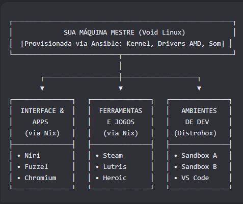

# BionicVoid

> **Void Linux purista** — base mínima e previsível (Ansible) + aplicativos declarativos (Nix/Home Manager) + desenvolvimento isolado em containers (Podman/Distrobox).

**Status:** 🟡 Fase 0 pendente · **Próxima ação:** criar a VM Void no virt-manager e fechar o checklist da Fase 0
**Alvo atual:** máquina virtual (QEMU/KVM) · **Nó de controle:** Debian + Ansible · **Bare metal:** fase futura

---

## 🧭 1. Visão Geral

### Missão

Construir um Void Linux que seja apenas um **motor**: base mínima, previsível e raramente tocada. Todo o software de usuário entra de forma **declarativa e reproduzível** (Nix + Home Manager) e todo ambiente de desenvolvimento vive **isolado em containers** (Podman + Distrobox).

O objetivo real é nunca mais voltar à estaca zero: qualquer máquina pode ser reconstruída a partir deste repositório.

### As camadas (o que vai em cada uma)

| Camada | Ferramenta | O que cobre | Exemplos |
|---|---|---|---|
| **Sistema** (instalar/supervisionar) | Ansible + xbps | serviços e componentes do sistema | kernel, firmware AMD, PipeWire, Podman, Nix, polkit, keyring, dbus |
| **Usuário** (binários/config) | Nix + Home Manager | aplicativos e configuração pessoal | Niri, Fuzzel, Chromium, terminal, fontes, jogos |
| **Projeto** (runtime isolado) | Podman + Distrobox | ferramentas de desenvolvimento | Python, Node.js, C++, VS Code |

**Regra de ouro:** é serviço/instalação de sistema? → Ansible. É app ou configuração de usuário? → Nix/Home Manager. É ferramenta de projeto? → container. Componentes de sessão (polkit, keyring, PipeWire) **instalam-se como sistema** e **iniciam na sessão**.

### Convenções do projeto

1. **Sem código neste README** — aqui é plano/roadmap: nenhum comando, nenhum bloco de código. Código (playbooks, configs Nix, scripts) vive em arquivos próprios (`ansible/`, `nix/`, `scripts/`), com regras de estilo próprias.
2. **Partes conforme o fluxograma** — a divisão do roadmap espelha `imgs/Fluxograma_Ecossistema_Perfeito.png`.
3. **Estilo sem excesso** — organização visual a serviço da execução; nada de enfeite que não ajude a executar.

### Princípios anti-retrabalho

- **Snapshot antes de cada parte** — rollback de minutos, nunca de semanas.
- **Uma parte por vez** — não se avança sem cumprir o critério de aceite da parte atual.
- **Tudo declarativo** — o que funcionou está no repositório e roda de novo em qualquer máquina.
- **Nada destrutivo sem confirmação** — vale para humano e para IA (ver §9).

**Fluxo de uso:** veja o que está em andamento no §7 → execute os passos da parte no §5 → marque os critérios de aceite → commite atualizando o status.

---

## 🗺️ 2. Arquitetura

### Blocos do fluxograma → partes do roadmap

| Bloco do fluxograma | Ferramenta | Conteúdo | Parte |
|---|---|---|---|
| MÁQUINA MESTRE (provisionada via Ansible) | Ansible + xbps | Kernel, drivers AMD, som, Podman, Nix | Parte 1 |
| INTERFACE & APPS | Nix + Home Manager | Niri, Fuzzel, Chromium (+ terminal, fontes, utilidades) | Parte 2 |
| AMBIENTES DE DEV | Podman + Distrobox | Sandbox A, Sandbox B, VS Code | Parte 3 |
| FERRAMENTAS E JOGOS | Nix + Home Manager | Steam, Lutris, Heroic | Parte 4 |

**Ordem de execução:** 1 → 2 → 3 → 4. Dev (3) vem antes de Jogos (4) porque é 100% validável na VM; Jogos tem validação apenas funcional por ora (na VM não há GPU real). A matriz do §6 amarra a ordem ao desenho do fluxograma.

---

## 🧰 3. Fase 0 — VM Pronta (pré-requisitos)

Nada aqui é feito por Ansible: é a preparação manual documentada do alvo, feita **uma única vez**. A VM é descartável e recriável — trate-a como tal.

**Hypervisor:** QEMU/KVM + virt-manager, com virtio-gpu e aceleração 3D (virgl).

- [ ] ISO do Void **glibc** (nunca musl — Nix e Steam dependem de glibc)
- [ ] VM: 4+ vCPU · 8–16 GB RAM · disco único qcow2 de 60+ GB (cresce sob demanda)
- [ ] Firmware UEFI; layout de disco simples (sem LVM/LUKS nesta fase)
- [ ] Rede NAT com encaminhamento da porta SSH (alternativa: bridge com IP fixo — decisão §10)
- [ ] Instalação pelo instalador oficial do Void (`void-installer`): teclado, disco, rede, hostname, fuso (America/Sao_Paulo), locale (pt_BR.UTF-8 + en_US.UTF-8), usuário no grupo `wheel`, serviços básicos, GRUB
- [ ] Hostname padrão: `bionicvoid-vm`
- [ ] `chrony` (relógio), `qemu-guest-agent` e `spice-vdagent` (integração com o host)
- [ ] `python3` instalado (exigência do Ansible no alvo)
- [ ] SSH por chave a partir do nó de controle Debian; senha e login de root desabilitados **somente depois** do SSH validado
- [ ] Troca de arquivos host↔VM definida (o clipboard do SPICE é limitado em Wayland — alternativa garantida: cópia via SSH)
- [ ] Snapshot do hypervisor chamado `fase-0-limpa`

**Dica:** mantenha uma sessão SSH aberta durante mudanças estruturais — é a sua corda de segurança.

---

## 🗂️ 4. Estrutura do Repositório (proposta)

| Caminho | Conteúdo | Estado |
|---|---|---|
| `ansible/` | provisionamento da base (Parte 1): inventário, playbook, roles | futuro |
| `nix/` | flake + módulos do Home Manager (Partes 2 e 4) | futuro |
| `scripts/` | atalhos de operação: sandboxes e utilitários (Parte 3) | futuro |
| `docs/` | documentação por parte (`parte-1-base.md`, `parte-2-interface.md`, `parte-3-dev.md`, `parte-4-jogos.md`) + histórico | em uso |
| `imgs/` | fluxograma e diagramas | em uso |

Nada é criado antes de a parte correspondente começar — este README é o contrato; os diretórios nascem com o primeiro artefato. O rascunho original fica em `docs/Plano.txt` (histórico); `docs/Void_Ansible.txt` é insumo da futura fase bare-metal (fora de escopo agora).

---

## 🚀 5. Roadmap

Template fixo de cada parte: 🎯 Objetivo · 📦 Entregáveis · 🪜 Passos · ✅ Critérios de Aceite · 📁 Artefatos Futuros · ⚠️ Pontos de Atenção · 🔗 Dependências.
Tags dos passos: `[SISTEMA]` Ansible/xbps · `[USUÁRIO]` Nix/Home Manager · `[CONTAINER]` Distrobox.

### 🔧 Parte 1 — A Base Sólida: Void como motor

**🎯 Objetivo:** transformar a VM Void mínima num motor totalmente provisionado por Ansible — kernel, firmware, áudio, containers e Nix — de forma idempotente e reconstruível.

**📦 Entregáveis**

- Playbook Ansible completo e idempotente (2ª execução sem nenhuma mudança)
- VM com kernel gerenciado, firmware AMD parametrizado, áudio instalado, Podman rootless funcional e Nix multi-user operante com flakes
- `ansible/` no repositório, com inventário apontando para a VM

**🪜 Passos**

1. `[SISTEMA]` Preparar o nó de controle (Debian): conferir o Ansible, criar a estrutura `ansible/` (inventário, configuração, playbook, roles) e definir convenções de nomes.
2. `[SISTEMA]` Bootstrap do alvo: repositórios do xbps (incluindo `nonfree`, para firmware), atualização completa do sistema, fuso/locale, `python3`, chave SSH; acesso privilegiado via `doas` (usuário `wheel`).
3. `[SISTEMA]` Kernel e boot: pacote `linux-lts` (linha fixa e previsível — validar nome), geração de initramfs, configuração do GRUB e reboot controlado pelo próprio playbook.
4. `[SISTEMA]` Firmware AMD: habilitação do repositório nonfree e instalação do pacote de firmware (validar nome). Na VM o efeito é inerte (não há GPU AMD real) — deixar atrás de variável do playbook para valer no bare-metal.
5. `[SISTEMA]` Áudio: `pipewire` + `wireplumber` + `pipewire-pulse` (clientes PulseAudio, como o Steam, dependem do pulse). A instalação é do sistema; a execução acontece na sessão (Parte 2).
6. `[SISTEMA]` Podman rootless: sub-IDs do usuário (`/etc/subuid` e `/etc/subgid`), ferramentas auxiliares (`fuse-overlayfs`, `slirp4netns`), teste com container descartável rodando sem root.
7. `[SISTEMA]` Nix: instalação multi-user adaptada ao runit (pacote xbps ou instalador oficial adaptado — validar), serviço do daemon em `/etc/sv` (validar se o pacote já o traz), configuração `/etc/nix/nix.conf` com flakes e trusted-users habilitados.
8. `[SISTEMA]` Fechamento: rodar o playbook duas vezes (idempotência), atualizar o Status e documentar em `docs/parte-1-base.md`.

**✅ Critérios de Aceite**

- [ ] Playbook roda do zero numa VM recém-criada e provisiona tudo
- [ ] Segunda execução não altera nada (idempotente)
- [ ] SSH com privilégio funcionando do Debian para a VM
- [ ] Container de teste roda sem root
- [ ] Nix disponível com flakes habilitadas
- [ ] Kernel atualizado e reboot aplicado

**📁 Artefatos Futuros:** `ansible/ansible.cfg` · `ansible/inventory.ini` · `ansible/playbooks/base.yml` · `ansible/roles/*` · `docs/parte-1-base.md`

**⚠️ Pontos de Atenção**

- O módulo `service` do Ansible não entende runit: usar o módulo de runit da comunidade (validar) ou symlink em `/var/service` com verificação idempotente.
- A atualização completa do xbps nunca é idempotente: isolá-la do resto e tratar o reboot com handler.
- Validar na execução: nome do pacote de firmware AMD, disponibilidade do serviço `nix-daemon`, linha de kernel.
- Firmware AMD não tem efeito dentro da VM — validação plena só no bare-metal.

**🔗 Dependências:** Fase 0 concluída.

---

### 🖥️ Parte 2 — Interface & Apps: o desktop declarativo

**🎯 Objetivo:** subir o ambiente gráfico Wayland (Niri) e os apps essenciais, 100% descritos em Nix/Home Manager — sessão reproduzível a partir de um único repositório.

**📦 Entregáveis**

- `nix/` no repositório: flake com nixpkgs pinado + módulos do Home Manager
- Sessão Niri funcional a partir do TTY, com áudio, notificações, clipboard, screenshot e lock
- Chromium acelerado em Wayland, terminal, Fuzzel e fontes instalados declarativamente

**🪜 Passos**

1. `[USUÁRIO]` Estruturar `nix/`: flake com nixpkgs pinado (release fixa + `flake.lock`) e módulos do Home Manager; perfil standalone para distro non-NixOS (`targets.genericLinux`, locale em `LOCALE_ARCHIVE`).
2. `[USUÁRIO]` Base de sessão declarativa: polkit agent, keyring, dbus de sessão e portais XDG (`xdg-desktop-portal` + backend gtk + backend wlr).
3. `[SISTEMA]` Mecanismo de login: subir a sessão com `niri-session` a partir do TTY — dispensa session file em `/usr` (evita o atrito do greetd com apps vindos do Nix), desde que o PATH do perfil Nix esteja visível no login.
4. `[USUÁRIO]` Niri: configuração de saída, teclas, layout e autostarts **na ordem**: dbus → polkit → keyring → pipewire/wireplumber/pulse → portais → notificações → clipboard.
5. `[USUÁRIO]` Apps base: terminal (foot), Fuzzel, Chromium (flags Wayland), fontes Nerd + fontconfig, notificações (mako), clipboard (wl-clipboard + cliphist — validar suporte a data-control), screenshot (grim + slurp), idle/lock (swayidle + lock) e XWayland (xwayland-satellite).
6. `[USUÁRIO]` Validar GPU na VM: conferir aceleração EGL/virgl; se cair em llvmpipe (software), revisar a configuração da VM **antes** de julgar performance.
7. `[USUÁRIO]` Teste "fresh home": mover `~/.config`, reaplicar o Home Manager e confirmar que a sessão volta sem passos manuais.
8. `[USUÁRIO]` Fechamento: atualizar o Status e documentar em `docs/parte-2-interface.md`.

**✅ Critérios de Aceite**

- [ ] Niri sobe a partir do TTY com um único passo de sessão
- [ ] Fuzzel localiza e abre apps; o terminal abre pelo Fuzzel
- [ ] Chromium roda em Wayland com aceleração (não software)
- [ ] Som audível (PipeWire ativo na sessão)
- [ ] Clipboard, screenshot e lock funcionando
- [ ] "Fresh home" reaplica a configuração sem passos manuais

**📁 Artefatos Futuros:** `nix/flake.nix` · `nix/home.nix` · `nix/modules/*` · `docs/parte-2-interface.md`

**⚠️ Pontos de Atenção**

- Home Manager em distro non-NixOS: módulos baseados em systemd viram no-op silencioso — autostarts são responsabilidade do Niri.
- A ordem dos autostarts importa (PipeWire antes de apps de mídia; portais antes do Chromium).
- Confirmar na execução: flags Wayland do Chromium, suporte a data-control do cliphist, backend de portal recomendado para o Niri.

**🔗 Dependências:** Parte 1 (Nix e áudio instalados) + Fase 0.

---

### 📦 Parte 3 — Ambientes de Dev: sandboxes isolados

**🎯 Objetivo:** isolar cada stack de desenvolvimento em um container Distrobox, com projetos persistindo no home do host e integração visual com a sessão.

**📦 Entregáveis**

- Distrobox instalado via Ansible (motor da camada de projetos)
- Sandbox A e Sandbox B criados, documentados e acessíveis pelo terminal e pelo Fuzzel
- `~/Projetos` no host, compartilhado com os sandboxes; VS Code operando no fluxo escolhido

**🪜 Passos**

1. `[SISTEMA]` Instalar o `distrobox` via Ansible e validar o Podman rootless herdado da Parte 1.
2. `[CONTAINER]` Definir as imagens base (decisão §10) e criar o Sandbox A (Python) e o Sandbox B (Node.js/C++).
3. `[CONTAINER]` Instalar a toolchain **dentro** de cada sandbox (Python com gerenciador moderno tipo uv/pipx; Node com fnm/nvm; C++ com gcc/clang + cmake).
4. `[CONTAINER]` Persistência e organização: projetos em `~/Projetos/<runtime>` no host; dotfiles dos containers separados por subpasta para evitar colisão com o home principal.
5. `[CONTAINER]` VS Code: comparar os dois caminhos (code-oss dentro do sandbox com exportação de GUI, ou VS Code no host via Nix + conexão remota ao container) e fixar um (§10).
6. `[USUÁRIO]` Integração com a sessão: entradas no Fuzzel para terminais e apps dos sandboxes; exportação de aplicativos quando fizer sentido.
7. `[CONTAINER]` Teste de persistência: recriar um sandbox do zero e confirmar que código e configurações permanecem.
8. `[SISTEMA]` Fechamento: atualizar o Status e documentar em `docs/parte-3-dev.md`.

**✅ Critérios de Aceite**

- [ ] Entrar num sandbox pelo terminal e pelo Fuzzel
- [ ] Janela de um app gráfico do container aparece na sessão Niri
- [ ] Projeto criado dentro do sandbox persiste fora dele
- [ ] Recriar um sandbox não perde código
- [ ] VS Code abre um projeto de `~/Projetos` pelo caminho escolhido

**📁 Artefatos Futuros:** `scripts/sandbox-a.sh` · `scripts/sandbox-b.sh` · `docs/parte-3-dev.md`

**⚠️ Pontos de Atenção**

- Home compartilhado entre sandboxes = risco de colisão de dotfiles; separar por subpasta.
- Fontes e cursor não são herdados automaticamente pelos containers.
- Confirmar na execução: serviço de socket do Podman sob runit (para o caminho remoto do VS Code); apps X11 dependem do xwayland-satellite.

**🔗 Dependências:** Parte 1 (Podman) + Parte 2 (sessão gráfica e Fuzzel).

---

### 🎮 Parte 4 — Ferramentas & Jogos: entretenimento declarativo

**🎯 Objetivo:** Steam, Lutris e Heroic instalados via Nix/Home Manager, com os runtimes necessários (incluindo 32-bit). Na VM, validação apenas funcional; performance real fica para o hardware.

**📦 Entregáveis**

- Módulo `nix/modules/gaming.nix` com Steam, Lutris, Heroic e ferramentas de suporte
- Steam logando e navegável; Lutris e Heroic abrindo
- Limite de validação da VM registrado na documentação

**🪜 Passos**

1. `[USUÁRIO]` Habilitar pacotes unfree no flake (Steam é unfree) e confirmar as dependências 32-bit **do próprio Nix** — não habilitar multilib do Void.
2. `[USUÁRIO]` Steam em ambiente FHS (wrappers do Nix), com user namespaces disponíveis para o sandbox do app.
3. `[USUÁRIO]` Lutris (wine) e Heroic; gamemode/gamescope como ferramentas de apoio.
4. `[USUÁRIO]` Validação funcional na VM: abrir, logar, navegar — **sem** expectativa de performance 3D (renderização por software).
5. `[USUÁRIO]` Fechamento: atualizar o Status e documentar em `docs/parte-4-jogos.md`, registrando que a validação plena será no bare-metal.

**✅ Critérios de Aceite**

- [ ] Steam abre, loga e mostra a biblioteca
- [ ] Lutris e Heroic abrem
- [ ] Nenhum app reclama de bibliotecas 32-bit ausentes
- [ ] Limite de validação (funcional na VM / performance no hardware) registrado

**📁 Artefatos Futuros:** `nix/modules/gaming.nix` · `docs/parte-4-jogos.md`

**⚠️ Pontos de Atenção**

- Unfree + ambiente FHS exigem configuração explícita no flake.
- Downloads pesados (dezenas de GB) — atenção ao disco da VM.
- Áudio dos jogos depende do `pipewire-pulse` (instalado na Parte 1).

**🔗 Dependências:** Parte 2 (sessão gráfica) + Parte 1 (áudio).

---

## 🔍 6. Matriz de Rastreabilidade

| Bloco do fluxograma | Parte | Passos-chave | Artefatos futuros |
|---|---|---|---|
| MÁQUINA MESTRE — Void provisionado via Ansible (Kernel, Drivers AMD, Som) | Parte 1 | 1–8 | `ansible/*` + `docs/parte-1-base.md` |
| INTERFACE & APPS — Niri, Fuzzel, Chromium | Parte 2 | 1–8 | `nix/*` + `docs/parte-2-interface.md` |
| AMBIENTES DE DEV — Sandbox A, Sandbox B, VS Code | Parte 3 | 1–8 | `scripts/*` + `docs/parte-3-dev.md` |
| FERRAMENTAS E JOGOS — Steam, Lutris, Heroic | Parte 4 | 1–5 | `nix/modules/gaming.nix` + `docs/parte-4-jogos.md` |

---

## ✅ 7. Status de Execução

| Fase/Parte | Estado | Observações |
|---|---|---|
| Fase 0 — VM pronta | ⬜ não iniciada | virt-manager + ISO glibc + snapshot inicial |
| Parte 1 — Base (Ansible) | ⬜ não iniciada | Kernel, firmware, som, Podman, Nix |
| Parte 2 — Interface & Apps (Nix) | ⬜ não iniciada | Niri, Fuzzel, Chromium, utilitários |
| Parte 3 — Ambientes de Dev (Distrobox) | ⬜ não iniciada | Sandboxes A/B + VS Code |
| Parte 4 — Ferramentas & Jogos (Nix) | ⬜ não iniciada | Steam, Lutris, Heroic |
| Bare metal | ⏸️ fora de escopo | Reaproveitar `docs/Void_Ansible.txt` no futuro |

Legenda: ⬜ não iniciada · 🟡 em andamento · ✅ concluída · ⏸️ fora de escopo.

**Regra:** ao fechar cada parte, atualizar esta tabela **no mesmo commit** da documentação da parte. Os checkboxes detalhados ficam dentro de cada parte (§5).

---

## ⚠️ 8. Riscos e Pitfalls (transversais)

| Risco | Impacto | Mitigação |
|---|---|---|
| runit ≠ systemd | Módulos e roles prontos de systemd falham; serviços não sobem | Tudo de serviço passa por `/etc/sv` + `/var/service`; confirmar o módulo de runit do Ansible |
| Home Manager em distro não-NixOS | Módulos baseados em systemd viram no-op silencioso | Usar só o que é suportado; autostart pelo Niri |
| VM sem GPU real ou sem virgl | Niri/Chromium lentos; jogos injogáveis | virtio-gpu + virgl; checar EGL; aceite funcional na VM, validação plena no hardware |
| Pacotes unfree e 32-bit (Steam) | Instalação falha ou app não abre | unfree habilitado no flake; 32-bit do próprio Nix; nunca multilib do Void |
| Atualização do xbps não idempotente | Playbook "sujo" quebra a confiança na automação | Isolar a atualização; teste de dupla execução é critério de aceite |
| User namespaces (userns) | Podman rootless e sandbox do Steam dependem disso | Confirmar suporte no kernel do Void antes de culpar os apps |
| Perda de progresso | Voltar à estaca zero | Snapshot antes de cada parte + tudo declarativo versionado no git |

---

## 🤖 9. Contrato de Execução (humano ou IA)

Regras para quem executa este roadmap — inclusive qualquer IA operando o projeto:

1. **Um passo por vez.** Nada de "já que estou aqui...".
2. **Snapshot da VM antes de cada parte.**
3. **Parar ao fim de cada passo** e verificar o critério de aceite correspondente.
4. **Nada destrutivo** (apagar, particionar, reinstalar) sem confirmação explícita.
5. **Atualizar o Status (§7) e commitar** ao fechar cada parte.
6. **Falhou?** Registrar o erro na documentação da parte, corrigir e repetir — nunca seguir adiante sobre base quebrada.
7. **Antes de criar qualquer arquivo**, conferir o planejado nos §4 e §5.

---

## ❓ 10. Decisões em Aberto

| # | Decisão | Opções | Quando decidir |
|---|---|---|---|
| 1 | Specs finais da VM e rede/IP | NAT + forward (recomendado) vs bridge; reserva de IP | Fase 0 |
| 2 | Linha de kernel | `linux-lts` (recomendado, previsível) vs rolling | Parte 1 |
| 3 | Swap + zram | arquivo vs partição; tamanho | Parte 1 |
| 4 | Supervisão do PipeWire | autostart do Niri (recomendado) vs runsvdir de usuário | Parte 2 |
| 5 | Backend do portal XDG | gtk + wlr (recomendado) vs gnome | Parte 2 |
| 6 | Launcher | Fuzzel (recomendado) vs Rofi | Parte 2 |
| 7 | Navegador | Chromium (recomendado) vs Chrome vs Ungoogled | Parte 2 |
| 8 | Mapeamento dos sandboxes | A = Python, B = Node.js/C++ (confirmar) | Parte 3 |
| 9 | VS Code | code-oss no sandbox + export vs VS Code no host + remoto | Parte 3 |
| 10 | Imagens base do Distrobox | Ubuntu LTS / Fedora / Debian | Parte 3 |
| 11 | Política de snapshot e updates | quando/como atualizar VM, flake e xbps | contínuo |
| 12 | greetd (login gráfico na inicialização) | opcional, como polimento pós-Parte 2 | futuro |

---

## 📚 11. Glossário & Referências

### Glossário

| Termo | O que é |
|---|---|
| Ansible | Ferramenta de automação: descreve o estado desejado do sistema em playbooks, sem script imperativo |
| xbps | Gerenciador de pacotes do Void Linux |
| runit | Sistema de init e supervisão de serviços do Void — **não é systemd** |
| Nix | Gerenciador de pacotes declarativo e reproduzível; instala apps isolados na sua própria store |
| Flake | Projeto Nix versionado, com dependências travadas por arquivo de lock |
| Home Manager | Camada que descreve os apps e configurações de usuário em Nix |
| Podman | Motor de containers rootless (sem daemon e sem root) |
| Distrobox | Cria containers integrados ao host (home compartilhada, GUI, entradas de menu) |
| Niri | Compositor Wayland de janelas em coluna rolável |
| PipeWire | Servidor de áudio/vídeo do sistema; o `pipewire-pulse` atende clientes PulseAudio |
| Portal XDG | Pontes que dão aos apps acesso a recursos do desktop (captura de tela, diálogos, etc.) |
| Wayland | Protocolo gráfico moderno do Linux — o Niri roda sobre ele |

### Referências

- Void Linux — https://docs.voidlinux.org
- Void Linux — Serviços (incluindo serviços de usuário) — https://docs.voidlinux.org/config/services/index.html
- Ansible — https://docs.ansible.com
- Nix — https://nixos.org/manual/nix/stable/
- Busca de pacotes do Nix — https://search.nixos.org
- Home Manager — https://nix-community.github.io/home-manager/
- Podman — https://docs.podman.io
- Distrobox — https://distrobox.it
- Niri (wiki) — https://github.com/YaLTeR/niri/wiki
- PipeWire — https://pipewire.org
